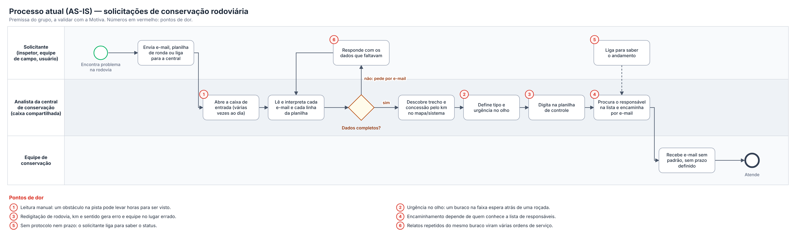
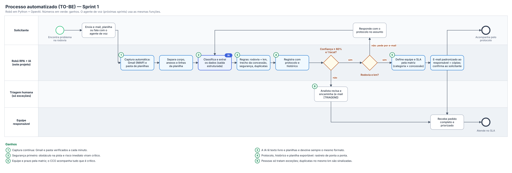
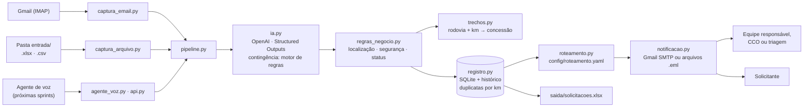

# Motiva · Robô de Conservação Rodoviária — Sprint 1

**Challenge Motiva · AI for Robotic Process Automation**
Sprint 1 — *Receber, entender e encaminhar*

O desafio propõe um **agente de voz para apoiar profissionais de operações rodoviárias e manutenção em campo**. Esta Sprint constrói a base desse agente: o robô que recebe uma **solicitação de conservação da rodovia** (buraco, placa caída, defensa danificada, bueiro entupido, iluminação apagada, objeto na pista…), entende o que é e onde fica, registra e encaminha para a equipe certa.

1. **captura** solicitações que chegam por **e-mail (Gmail)** e por **planilha (Excel ou CSV)** — relatórios de ronda, checklists de inspeção, exportações da ouvidoria;
2. usa **IA (OpenAI)** para **classificar** (tipo e urgência) e **extrair** os dados do registro: rodovia, km, sentido, faixa, obstrução da pista, risco imediato, quem relatou;
3. aplica **regras de negócio**: valida rodovia e km, localiza o trecho e a concessão, prioriza segurança e avisa quando o mesmo problema já foi relatado;
4. **registra** cada solicitação com **protocolo** e histórico;
5. **encaminha** automaticamente para a equipe responsável, com prazo (SLA), e confirma ao solicitante;
6. expõe **funções que o agente de voz** das próximas sprints vai chamar.

```bash
python main.py demo --limpar      # roda tudo com as amostras, sem precisar de Gmail
```

---

## Sumário

1. [A solicitação escolhida](#1-a-solicitação-escolhida)
2. [O que a Sprint pede × onde está no projeto](#2-o-que-a-sprint-pede--onde-está-no-projeto)
3. [Processo antes e depois da automação](#3-processo-antes-e-depois-da-automação)
4. [Arquitetura](#4-arquitetura)
5. [Como a IA é usada](#5-como-a-ia-é-usada)
6. [Regras de negócio](#6-regras-de-negócio)
7. [Como rodar](#7-como-rodar)
8. [Funções para o agente de voz](#8-funções-para-o-agente-de-voz)
9. [Registro estruturado](#9-registro-estruturado)
10. [Estrutura do repositório](#10-estrutura-do-repositório)
11. [Testes](#11-testes)
12. [Segurança e LGPD](#12-segurança-e-lgpd)
13. [Limitações e próximos passos](#13-limitações-e-próximos-passos)
14. [Equipe](#14-equipe)

---

## 1. A solicitação escolhida

**Solicitações de conservação rodoviária** — problemas na pista, na sinalização, nos dispositivos de segurança, na drenagem, na iluminação ou na faixa de domínio, que precisam de uma equipe no local.

| Solicitante | Exemplo | Canal típico |
|---|---|---|
| **Inspetor de tráfego** | "Buraco grande na faixa 3 da Bandeirantes, km 72+400, sentido capital. Carros desviando em cima da hora." | e-mail, rádio, planilha da ronda |
| **Equipe de campo** | "Bueiro do km 92 da Raposo entupido, água chegando na faixa." | e-mail, checklist semanal em Excel |
| **CCO** | "Árvore caída obstruindo a faixa da Rio-Santos, km 455." | e-mail |
| **Usuário da rodovia** | "Tem um buraco enorme depois do pedágio de Itapevi." | 0800, ouvidoria (exportação CSV), e-mail |

**Por que este processo:** é o dia a dia de quem trabalha em campo, o volume é alto, os relatos são livres e variados ("km 72 mais 400", "sentido capital", "faixa da direita") — bom caso para IA — e **a prioridade importa de verdade**: um obstáculo na faixa de rolamento não pode esperar na mesma fila que uma roçada de rotina. O destino depende de regras claras (tipo de serviço × trecho da concessão), e muitos relatos são do **mesmo problema**, o que gera ordens de serviço repetidas.

---

## 2. O que a Sprint pede × onde está no projeto

| Requisito da Sprint 1 | Como foi feito | Onde |
|---|---|---|
| Captura automática **por e-mail** | Lê os e-mails não lidos do Gmail via IMAP, a cada N segundos. Anexos `.csv`/`.xlsx` viram uma solicitação por linha. Marca como lido e aplica o marcador `Motiva-RPA/Processados`. | `src/motiva_rpa/captura_email.py` |
| Captura automática **por arquivo** (Excel ou CSV) | Vigia a pasta `entrada/`. Lê CSV com `;` ou `,`, em UTF-8 ou Windows-1252, acha o cabeçalho mesmo com linhas de título e reconhece colunas como "Rodovia", "KM", "Marco km", "Sentido", "Anomalia", "Manifestação". | `src/motiva_rpa/captura_arquivo.py` |
| **IA classifica** a solicitação | OpenAI com *Structured Outputs*: categoria (8 tipos), urgência (4 níveis), confiança e justificativa. | `src/motiva_rpa/ia.py`, `prompts/sistema_conservacao.md` |
| **IA extrai** os dados do registro | Rodovia, km, sentido, faixa/posição, referência, obstrução da pista, risco imediato, necessidade de interdição, dimensão, problemas, quem relatou e equipe de origem. | `src/motiva_rpa/modelos.py` (`AnaliseSolicitacao`) |
| **Registro estruturado** | SQLite com protocolo `CNS-AAAA-NNNNNN`, todos os campos, status e trilha de auditoria. Exporta para Excel. | `src/motiva_rpa/registro.py` |
| **Encaminhamento automático** ao responsável | Matriz configurável (categoria × concessão do trecho), prazo por urgência, cópias (CCO em tudo que é crítico, Engenharia em drenagem/taludes), e-mail padronizado ao responsável e confirmação ao solicitante. | `src/motiva_rpa/roteamento.py`, `config/roteamento.yaml`, `src/motiva_rpa/notificacao.py` |
| **Função para o agente de voz** | `registrar_solicitacao_conservacao`, `consultar_solicitacao`, `consultar_pendencias_trecho` e `complementar_solicitacao`, com definição de *tools* no formato OpenAI e API HTTP. | `src/motiva_rpa/agente_voz.py`, `src/motiva_rpa/api.py` |
| README | Este arquivo. | `README.md` |
| Desenho do processo antes e depois | Diagramas em raias (AS-IS e TO-BE). | `docs/processo_as_is.png`, `docs/processo_to_be.png` | 

---

## 3. Processo antes e depois da automação

### Antes (AS-IS)



> O processo atual é uma **premissa do grupo**, montada a partir do funcionamento típico de uma central de conservação com caixa compartilhada. Deve ser validada com a Motiva.

### Depois (TO-BE)



### O que muda em cada etapa

| Etapa | Antes | Depois |
|---|---|---|
| Recebimento | Analista abre a caixa várias vezes ao dia; planilhas de ronda lidas linha a linha | Robô verifica Gmail e pasta a cada minuto, 24 h por dia |
| Interpretação | Leitura humana, cada um com seu critério | IA devolve sempre os mesmos campos, com justificativa e confiança |
| Localização | Analista descobre trecho e concessão pelo km | Rodovia (código ou nome popular) + km localizam trecho, concessão e base de conservação |
| Prioridade | "No olho" | Critérios escritos + regras fixas de segurança (obstrução, risco imediato, termos como "queda de barreira", "óleo na pista") |
| Relatos repetidos | Viram várias ordens de serviço | Aviso de **possível duplicata** quando há solicitação aberta da mesma categoria a até 1 km, no mesmo sentido |
| Dados faltantes | E-mail manual, sem controle | Status `PENDENTE_INFORMACAO`, pedido automático e reanálise quando o solicitante responde com o protocolo |
| Registro | Digitação em planilha | Registro automático com protocolo, histórico e exportação para Excel |
| Encaminhamento | Depende de quem conhece a lista | Matriz em arquivo de configuração, com SLA e cópias para o CCO |
| Acompanhamento | Solicitante liga para perguntar | Confirmação com protocolo e prazo; consulta pelo agente de voz |
| Exceções | Tudo passa por uma pessoa | Pessoa só vê o que a IA não tem certeza (triagem) |

### Indicadores para medir o ganho

A tabela `historico` guarda o momento de cada etapa, então dá para medir sem esforço extra:

- **tempo entre o recebimento e o encaminhamento** (antes: horas, a medir na Motiva; depois: segundos após a leitura);
- **% de solicitações encaminhadas sem toque humano**;
- **% de urgências críticas encaminhadas em menos de 5 minutos**;
- **% de duplicatas evitadas** (solicitações marcadas como possível duplicata);
- **% de reclassificações feitas pela triagem** (mede a qualidade da IA em produção).

---

## 4. Arquitetura



Todos os canais viram o mesmo objeto (`Entrada`) e passam pelo mesmo `Pipeline`. Por isso um relato por voz, por e-mail ou por planilha gera exatamente o mesmo registro e o mesmo encaminhamento.

---

## 5. Como a IA é usada

### 5.1 O que a IA faz

Para cada solicitação, o robô manda à OpenAI o texto com os metadados da captura (canal, data, remetente, assunto, arquivo de origem) e recebe de volta um objeto `AnaliseSolicitacao`:

```json
{
  "categoria": "PAVIMENTO",
  "urgencia": "CRITICA",
  "confianca": 0.95,
  "justificativa": "Buraco grande na faixa de rolamento com veículos desviando bruscamente.",
  "resumo": "Buraco de ~80 cm na faixa 3 da SP-348 km 72+400 sentido capital; cones colocados, precisa de tapa-buraco.",
  "rodovia": "SP-348",
  "km": 72.4,
  "sentido": "capital",
  "local_na_via": "faixa 3",
  "obstrucao_pista": false,
  "risco_imediato": true,
  "interdicao_necessaria": true,
  "dimensao": "80 cm de diâmetro",
  "tipo_solicitante": "INSPECAO_TRAFEGO",
  "equipe_origem": "Inspeção 03",
  "...": "…"
}
```

*(exemplo ilustrativo; rode `python main.py testar-ia` com a chave para ver a resposta real)*

### 5.2 Decisões de projeto

| Decisão | Por quê |
|---|---|
| **Structured Outputs** (`client.chat.completions.parse` com um modelo Pydantic) | A resposta sempre segue o schema: categorias e urgências só podem ser os valores permitidos. Não há JSON quebrado para tratar. |
| **Prompt em arquivo** (`prompts/sistema_conservacao.md`) | Critérios de categoria, de urgência e casos de fronteira ficam legíveis e versionados; quem não programa consegue revisar. |
| **"Risco imediato" bem definido** | Defeito sério não é o mesmo que perigo agora. O prompt separa "buraco no acostamento" (média) de "buraco na faixa com carros desviando" (crítica), para não transformar tudo em crítico e cansar o CCO. |
| **Confiança + triagem humana** | Abaixo de 60% (configurável) a solicitação vai para a triagem com a sugestão da IA. |
| **Regras de negócio depois da IA** | O que não pode depender de interpretação fica em código: rodovia e km válidos, trecho da concessão, termos de segurança, duplicatas. Ver [seção 6](#6-regras-de-negócio). |
| **Colunas da planilha prevalecem** | Se a planilha de ronda tem a coluna "KM", ela vale mais que a leitura da IA. Divergências viram aviso. |
| **Defesa contra manipulação** | O prompt trata o conteúdo como dado, nunca como instrução. A amostra `10_tentativa_manipulacao.eml` testa isso. |
| **Contingência** | Sem chave ou com a API fora do ar, o robô usa um motor de regras (palavras-chave + regex) e marca o registro e o e-mail com esse aviso. A operação não para. |
| **Modelo configurável** | `OPENAI_MODEL` no `.env` (padrão `gpt-4.1-mini`, que não exige verificação da organização na OpenAI). |

### 5.3 Avaliação

`avaliacao/casos_rotulados.jsonl` tem **32 casos rotulados à mão**, escritos de forma diferente das amostras (abreviações de ronda, gírias de usuário, casos de fronteira, negações como "nada na pista além disso", tentativa de manipulação). O comando abaixo mede os dois motores e gera relatórios em `avaliacao/`:

```bash
python main.py avaliar --motor ambos
```

| Métrica | Regras (sem IA) | OpenAI |
|---|---|---|
| Categoria correta | 84% | 97% |
| Urgência correta (com regras de negócio) | 50% | 84% |
| Casos críticos detectados | 5/12 | 12/12 |
| Localização correta (rodovia + km) | 100% | 97% |

O motor de regras acha bem rodovia e km (são padrões fixos), mas erra justamente onde é preciso **interpretar**: não sabe que "pneu de caminhão no meio da faixa" é obstáculo crítico, não distingue "defensa arrancada na curva da ponte" de "defensa trincada em reta", trata "caminhão quebrado na faixa" como sinalização e cai na mensagem de manipulação. Veja `avaliacao/resultado_regras.md`.

---

## 6. Regras de negócio

> Categorias, critérios, prazos, equipes e trechos são **premissas do grupo** para o protótipo, a validar com a Motiva. Ficam em arquivos de configuração para serem ajustados sem mexer no código.

### Categorias e responsáveis

| Categoria | Exemplos | Responsável |
|---|---|---|
| `PAVIMENTO` | Buraco, trinca, afundamento, desnível | Conservação de Rotina da concessão |
| `SINALIZACAO` | Placa caída, pintura apagada, tachas | Sinalização e Dispositivos de Segurança |
| `DISPOSITIVOS_SEGURANCA` | Defensa, barreira, atenuador, cerca | Sinalização e Dispositivos de Segurança |
| `DRENAGEM_TALUDES` | Bueiro, alagamento, erosão, queda de barreira | Conservação da concessão + cópia Engenharia |
| `ILUMINACAO` | Postes, trevos, túneis, fios caídos | Manutenção Elétrica e Iluminação |
| `VEGETACAO_LIMPEZA` | Roçada, árvore, entulho, objeto ou óleo na pista | Conservação de Rotina da concessão |
| `OCORRENCIA_TRAFEGO` | Acidente, veículo parado, animal na pista | Centro de Controle Operacional (CCO) |
| `FORA_ESCOPO` | Pedágio, TAG, reembolso, elogio | Ouvidoria |

A **concessão** vem do cadastro de trechos (`dados/trechos_motiva.csv`): rodovia + km → Motiva Autoban, ViaOeste, RioSP ou ViaSul. As faixas de km do cadastro são **ilustrativas**, não os limites contratuais.

### Urgência e prazo de atendimento

| Urgência | Critério | SLA |
|---|---|---|
| **CRÍTICA** | Risco imediato: obstáculo na faixa, buraco grande em faixa de tráfego rápido, defensa ausente em curva/ponte, água ou óleo na pista, fios caídos, túnel apagado, ocorrência de tráfego com pessoas na pista | 2 h |
| **ALTA** | Defeito na faixa sem obstrução, defensa danificada em reta, placa de regulamentação caída, bueiro entupido com chuva prevista, erosão avançando, árvore com risco de queda | 24 h |
| **MÉDIA** | Defeito no acostamento, pintura desgastada, tachas soltas, iluminação parcial | 72 h |
| **BAIXA** | Limpeza, roçada de rotina, fora do escopo | 7 dias |

### Regras aplicadas depois da IA (`regras_negocio.py`)

1. **Rodovia**: aceita código (`sp 280` → `SP-280`) ou nome popular (`Castello`, `Dutra`, `Freeway` → código). Se a IA não achar, procura no texto.
2. **Km**: `72+400`, `72,4`, `km 72 mais 400` → `72.4`; fora de 0–1500 é descartado.
3. **Sentido**: normaliza `capital`, `interior`, `norte`…; cidades de destino ficam como estão ("Rio de Janeiro").
4. **Colunas da planilha / campos da ligação** prevalecem sobre o texto.
5. **Cadastro de trechos**: completa concessão, trecho e base de conservação; avisa se o km está fora dos trechos ou se a rodovia não é da concessionária.
6. **Segurança**: se a IA marcar obstrução ou risco imediato, **ou** se aparecerem termos como "queda de barreira", "óleo na pista", "fios caídos", "obstruindo" → urgência CRÍTICA (rede de proteção independente da IA, que ignora negações como "nada na pista").
7. **Interdição necessária** → urgência mínima ALTA.
8. **Duplicatas**: solicitação aberta da mesma categoria, mesma rodovia, até 1 km de distância e mesmo sentido → aviso de possível duplicata no registro, no e-mail e na fala do agente.
9. **Status**:
   - confiança abaixo do mínimo, ou mais de um local na mensagem → `EM_TRIAGEM`;
   - fora do escopo → `ENCAMINHADA` à Ouvidoria;
   - falta rodovia ou km e há contato → `PENDENTE_INFORMACAO` e pedido automático;
   - falta dado mas é **crítica** ou ocorrência de tráfego → encaminha assim mesmo, com aviso (segurança antes de burocracia);
   - completo → `ENCAMINHADA`.
10. **Cópias**: tudo que é crítico vai com cópia para o CCO; drenagem e taludes, para a Engenharia.

Cada regra aplicada vira um **aviso** no registro e no e-mail ao responsável.

---

## 7. Como rodar

### 7.1 Instalação

Requer **Python 3.10 ou mais novo**.

```bash
git clone <url-do-repositorio>
cd motiva-conservacao-rpa
python -m venv .venv
# Windows:      .\.venv\Scripts\Activate.ps1
# macOS/Linux:  source .venv/bin/activate
python -m pip install -r requirements.txt
cp .env.example .env          # no Windows: copy .env.example .env
```

### 7.2 Demonstração sem Gmail (funciona sem nenhuma chave)

```bash
python main.py demo --limpar
```

Processa os 11 e-mails de `amostras/emails/` (um com a planilha da ronda noturna anexada), as 2 planilhas de `amostras/planilhas/` (checklist de inspeção em Excel e exportação da ouvidoria em CSV) e simula a resposta de uma usuária a um pedido de informação. Resultado:

- tabela com protocolo, categoria, urgência, responsável e status de cada solicitação;
- `saida/solicitacoes.xlsx` com o registro e o histórico;
- `saida/emails/*.eml` com cada e-mail que o robô enviaria.

Sem `OPENAI_API_KEY`, a demo usa o motor de regras e avisa isso em cada registro. Com a chave, usa a IA.

### 7.3 Ligar a IA

No `.env`:

```ini
OPENAI_API_KEY= { SUA CHAVE AQUI }
OPENAI_MODEL=gpt-4.1-mini
OPENAI_REASONING_EFFORT=
```

Teste: `python main.py testar-ia`. A primeira linha mostra qual motor respondeu.

### 7.4 Ligar o Gmail

1. Criem uma **conta Gmail pessoal (contas institucionais costumam bloquear senha de app).
2. Ative a **verificação em duas etapas** em myaccount.google.com/security.
3. Gere uma **senha de app** em myaccount.google.com/apppasswords (16 letras).
4. No `.env`:

```ini
GMAIL_USUARIO=grupo.demo@gmail.com
GMAIL_SENHA_APP=abcdabcdabcdabcd
ENVIO_MODO=smtp
ENVIO_REDIRECIONAR_PARA=grupo.demo@gmail.com
```

`ENVIO_REDIRECIONAR_PARA` manda todos os e-mails para a conta indicada, com o destinatário original no assunto, porque a matriz usa endereços fictícios `@example.com`. Alternativa: troque os e-mails em `config/roteamento.yaml` por aliases (`grupo.demo+cco@gmail.com`, `grupo.demo+sinalizacao@gmail.com`…).

O robô **ignora os próprios e-mails** (cabeçalho `X-Motiva-RPA`) e avisos automáticos, então não entra em loop.

> Com `ENVIO_MODO=smtp`, a `demo` envia cerca de 37 e-mails de verdade. Para rodar a demo, use `ENVIO_MODO=arquivo`.

### 7.5 Rodar o robô

```bash
python main.py monitorar                  # Gmail + pasta entrada/, a cada 60 s
python main.py monitorar --intervalo 20   # mais rápido para a demo
python main.py monitorar --sem-gmail      # só a pasta
```

Com o robô rodando: mande um e-mail de outra conta para a conta indicada, ou copie uma planilha para `entrada/`.

### 7.6 Todos os comandos

| Comando | O que faz |
|---|---|
| `python main.py demo [--limpar]` | Demonstração completa com as amostras |
| `python main.py monitorar` | Robô contínuo (Gmail + pasta) |
| `python main.py emails` | Lê o Gmail uma vez |
| `python main.py arquivos` | Lê a pasta `entrada/` uma vez |
| `python main.py listar [--status PENDENTE_INFORMACAO]` | Mostra o registro |
| `python main.py exportar` | Gera `saida/solicitacoes.xlsx` |
| `python main.py testar-ia "texto"` | Mostra o JSON que a IA devolve |
| `python main.py avaliar --motor ambos` | Mede IA e regras nos casos rotulados |
| `python main.py voz` | Simula um inspetor falando com o agente de voz |
| `python main.py api` | Sobe a API em http://localhost:8000/docs |

Para gerar novas amostras: edite e rode `python amostras/gerar_amostras.py`. Para redesenhar os diagramas: edite e rode `python docs/gerar_diagramas.py`.

---

## 8. Funções para o agente de voz

O agente de voz das próximas sprints conversa com o profissional em campo, entende o relato e chama uma destas funções. Elas usam o **mesmo pipeline** do e-mail e da planilha.

| Função | Para quê | Retorno principal |
|---|---|---|
| `registrar_solicitacao_conservacao(descricao, rodovia, km, sentido, local_na_via, referencia, nome_profissional, equipe_origem, telefone)` | Registra um problema novo | protocolo, status, equipe, prazo, localização, campos faltantes, possível duplicata |
| `consultar_solicitacao(protocolo)` | Status por protocolo | status, equipe, prazo, último evento |
| `consultar_pendencias_trecho(rodovia, km, raio_km=5)` | O que já está aberto perto de onde o profissional está | lista de solicitações abertas no trecho |
| `complementar_solicitacao(protocolo, informacao)` | Acrescenta o que faltou (ex.: o km) | status atualizado |

Toda resposta traz **`mensagem_para_falar`**, um texto curto pensado para quem está na beira da rodovia: rodovia e km falados por extenso ("S P 280, quilômetro 45 mais 300"), protocolo soletrado ("C N S, 2 0 2 6, …") e orientação de segurança quando a urgência é crítica.

### Em Python

```python
from motiva_rpa.agente_voz import FERRAMENTAS, executar_ferramenta

# FERRAMENTAS: definições no formato de tools da OpenAI (Realtime API / Responses API)
# Quando o modelo pedir uma chamada de função:
resultado = executar_ferramenta("registrar_solicitacao_conservacao",
                                '{"descricao": "placa de 100 caída", "rodovia": "Castello", "km": "45+300"}')
print(resultado["mensagem_para_falar"])
```

Exemplo de sessão (`python main.py voz`):

```text
→ registrar_solicitacao_conservacao(descricao="Placa de velocidade máxima 100 caída…", rodovia="Castello Branco", sentido="interior")
  "Anotei com o protocolo C N S, 2 0 2 6, … Para encaminhar, preciso de: km do local. Pode me informar?"
→ complementar_solicitacao(protocolo="CNS-2026-…", informacao="É no km 45 mais 300.")
  "Obrigado, anotei. A solicitação …, em S P 280, quilômetro 45 mais 300, sentido interior, está com Sinalização
   e Dispositivos de Segurança, com atendimento previsto até amanhã às 21:59. Atenção: já existe a solicitação
   C N S, 2 0 2 6, 0 0 0 0 0 2 aberta perto deste ponto."
→ consultar_pendencias_trecho(rodovia="SP-280", km="45", raio_km=10)
  "Há 4 solicitações abertas perto daí: …"
```

### Por HTTP (para plataformas de voz que chamam webhooks)

`python main.py api` e abra http://localhost:8000/docs.

| Método e rota | Função |
|---|---|
| `GET /voz/ferramentas` | Definições das ferramentas |
| `POST /voz/ferramentas/{nome}` | Despachante genérico (corpo = argumentos) |
| `POST /voz/solicitacoes` | Registrar |
| `GET /voz/solicitacoes/{protocolo}` | Consultar |
| `GET /voz/pendencias?rodovia=SP-280&km=45` | Pendências no trecho |
| `POST /voz/solicitacoes/{protocolo}/complemento` | Complementar |
| `GET /solicitacoes` · `GET /solicitacoes/{protocolo}/historico` | Registro e histórico |

---

## 9. Registro estruturado

Tabela `solicitacoes` (SQLite em `dados/solicitacoes.db`, exportável para Excel):

| Grupo | Campos |
|---|---|
| Identificação | `protocolo`, `canal`, `origem_ref` (Message-ID ou arquivo#linha), `arquivo_origem`, `recebido_em`, `criado_em`, `atualizado_em` |
| Classificação (IA) | `categoria`, `urgencia`, `confianca`, `justificativa`, `resumo`, `motor_ia` |
| Localização | `rodovia`, `km`, `sentido`, `local_na_via`, `referencia`, `cidade`, `uf`, `concessao`, `trecho`, `base_conservacao` |
| Situação no local | `obstrucao_pista`, `risco_imediato`, `interdicao_necessaria`, `dimensao`, `data_preferencial` |
| Solicitante | `tipo_solicitante`, `solicitante_nome`, `solicitante_email`, `solicitante_telefone`, `equipe_origem` |
| Controle | `status`, `motivo_status`, `campos_faltantes`, `avisos`, `possivel_duplicata` |
| Encaminhamento | `equipe_id`, `equipe_nome`, `equipe_email`, `copias`, `sla_horas`, `prazo_retorno` |
| Auditoria | `texto_original`, `dados_ia` (resposta completa da IA), `dados_estruturados` (colunas da planilha / campos da ligação) |

Tabela `historico`: `RECEBIDA`, `CLASSIFICADA`, `ENCAMINHADA` ou `ENVIADA_TRIAGEM`, `CONFIRMACAO_ENVIADA`, `PEDIDO_INFORMACAO_ENVIADO`, `COMPLEMENTO_RECEBIDO`, `REANALISADA`, `FALHA_ENVIO`…, com data e detalhe.

**Sem duplicidade de captura:** o mesmo e-mail (Message-ID) ou a mesma linha do mesmo arquivo nunca gera dois registros. (Relatos *diferentes* do mesmo problema geram registros separados, marcados como possível duplicata.)

---

## 10. Estrutura do repositório

```text
motiva-conservacao-rpa/
├── main.py                        # atalho: python main.py <comando>
├── requirements.txt
├── .env.example                   # configuração (copiar para .env)
├── config/roteamento.yaml         # matriz de equipes, concessões e SLA
├── prompts/sistema_conservacao.md # instruções da IA
├── dados/trechos_motiva.csv       # cadastro ilustrativo de trechos (rodovia + km → concessão)
├── src/motiva_rpa/
│   ├── captura_email.py           # Gmail IMAP e .eml
│   ├── captura_arquivo.py         # Excel/CSV e pasta monitorada
│   ├── ia.py                      # OpenAI (Structured Outputs) + motor de regras
│   ├── regras_negocio.py          # localização, segurança, status
│   ├── trechos.py                 # cadastro de trechos e nomes de rodovia
│   ├── registro.py                # SQLite, histórico, duplicatas, exportação
│   ├── roteamento.py              # equipe, cópias e prazo
│   ├── notificacao.py             # e-mails (SMTP ou .eml)
│   ├── pipeline.py                # orquestração de ponta a ponta
│   ├── robo.py                    # ciclos de captura e monitoramento
│   ├── agente_voz.py              # funções para o agente de voz
│   ├── api.py                     # API HTTP (FastAPI)
│   ├── avaliacao.py               # métricas da IA
│   └── __main__.py                # linha de comando
├── amostras/                      # e-mails e planilhas fictícios + gerador
├── avaliacao/                     # casos rotulados e relatórios
├── docs/                          # diagramas AS-IS/TO-BE e roteiro do vídeo
└── tests/                         # testes automatizados (pytest)
```

---

## 11. Testes

```bash
python -m pytest -q
```

55 testes cobrem: códigos e nomes de rodovia, km em vários formatos (`72+400`, `72,4`, `72 mais 400`), sentido; CSV com `;` e acentos do Windows; Excel com título antes do cabeçalho; e-mail com planilha anexa; ciclo do Gmail com caixa simulada; e-mails do próprio robô ignorados; todas as regras de urgência e status; trecho e concessão; duplicatas por km; pedido de informação e complemento pelo protocolo; contingência quando a OpenAI falha; mascaramento de CPF; chamada à OpenAI com Structured Outputs (cliente simulado); funções e API do agente de voz.

Os testes não usam internet nem chave de API.

---

## 12. Segurança e LGPD

- **Minimização de dados:** CPFs são mascarados antes de o texto ir para a IA; o original fica só no registro local.
- **Segredos fora do código:** chaves e senha de app só no `.env`, que está no `.gitignore`.
- **Senha de app** do Gmail em vez da senha da conta, revogável a qualquer momento.
- **Dados fictícios:** nomes, telefones, e-mails e relatos são inventados; domínios `.example`. As rodovias são reais, mas os problemas descritos e as faixas de km do cadastro são ilustrativos.
- **Manipulação por prompt:** o conteúdo é tratado como dado. A amostra 10 testa isso — e mostra que o motor de regras, sem IA, cai na manipulação.
- **Humano no circuito:** baixa confiança e mensagens com vários locais vão para triagem; tudo que é crítico vai com cópia para o CCO.

---

## 13. Limitações e próximos passos

**Limitações do protótipo**

- O cadastro de trechos é um CSV ilustrativo; na operação seria o sistema de ativos da concessionária.
- O SLA conta horas corridas e é o mesmo para todas as concessões; contratos reais têm prazos próprios por tipo de defeito.
- Fotos anexadas são listadas para o responsável, mas não analisadas.
- Uma mensagem com vários locais vai inteira para a triagem, em vez de ser dividida.
- SQLite atende um robô por vez; com várias instâncias, trocar por PostgreSQL.

**Próximas sprints**

- Agente de voz usando `FERRAMENTAS` (ex.: OpenAI Realtime API) para o profissional relatar com as mãos livres, com as mesmas funções deste repositório.
- Localização por GPS do celular (km calculado a partir da coordenada).
- Análise das fotos com modelo de visão (tamanho do buraco, tipo de dano).
- Painel de acompanhamento (SLA vencendo, mapa de pendências por trecho).
- Retorno das equipes (concluída / cancelada) atualizando o status e avisando o solicitante.
- Usar as reclassificações da triagem para melhorar o prompt.

---


Projeto acadêmico para o Challenge Motiva. Não é um sistema oficial da Motiva, os dados são fictícios.
